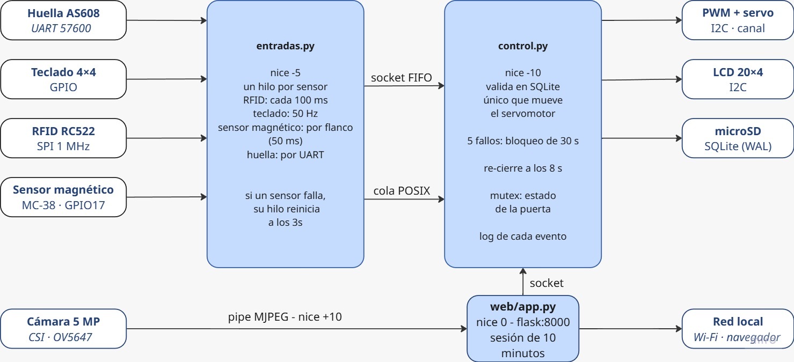

# Cerradura multifactor — Equipo 8 (FSE)

Arquitectura:
- Raspberry Pi 3B 
- Raspberry Pi OS Raspbian
- Python 3

Acceso con tarjeta RFID, PIN o huella; servomotor por PWM de hardware; LCD de estado;
sensor de puerta; app web con video en vivo, apertura remota e historial.



## Procesos

| Proceso (servicio) | Archivo | Qué hace | nice |
|---|---|---|---|
| `cerradura-control` | `control.py` | Valida credenciales, mueve el servo (PCA9685), LCD, logs, bloqueo por intentos | -10 |
| `cerradura-entradas` | `entradas.py` | Un hilo por sensor: huella (UART), RFID (SPI), teclado (GPIO), reed (GPIO) | -5 |
| `cerradura-web` | `web/app.py` | App web en el puerto 8000; la cámara (`rpicam-vid`) entra por un pipe con nice +10 | 0 |

Comunicación: entradas y web → control por **socket UNIX** (`/tmp/cerradura_control.sock`, una
solicitud a la vez); reed → control por **cola de mensajes POSIX** (`/cerradura_puerta`);
cámara → web por **pipe**. Usuarios y logs en SQLite (`/var/lib/cerradura/cerradura.db`).

| Archivo | Función |
|---|---|
| `config.py` | Pines, direcciones I2C, tiempos, prioridades |
| `db.py` | SQLite (WAL + synchronous=FULL); PIN con HMAC-SHA256, contraseñas web con scrypt |
| `ipc.py` | Socket UNIX y cola de mensajes |
| `admin.py` | Usuarios, PIN, tarjeta, huella, administradores web, logs, medición |
| `hw/` | Drivers propios: `pca9685.py`, `lcd.py` (PCF8574), `rc522.py` |
| `camara.py` | Lee el video MJPEG de `rpicam-vid` por un pipe |
| `web/` | `app.py` (Flask), `templates/`, `static/` (estilo y fuente Nunito, licencia OFL) |
| `evidencia.sh` | Junta la evidencia de terminal para el reporte |

## Conexiones

| Módulo | Pin del módulo | Raspberry Pi (pin físico) |
|---|---|---|
| **AS608** | VCC / GND | 3.3V (1) / GND (6) |
| | TX / RX | GPIO15 RXD (10) / GPIO14 TXD (8) |
| **RC522** | 3.3V y RST / GND | 3.3V (17) / GND (20) |
| | SDA(SS) / SCK | GPIO8 CE0 (24) / GPIO11 (23) |
| | MOSI / MISO | GPIO10 (19) / GPIO9 (21) |
| **Teclado 4x4** | F1 F2 F3 F4 | GPIO5 (29), GPIO6 (31), GPIO13 (33), GPIO19 (35) |
| | C1 C2 C3 C4 | GPIO12 (32), GPIO16 (36), GPIO20 (38), GPIO21 (40) |
| **Reed MC-38** | 2 cables | GPIO17 (11) y GND (9) |
| **PCA9685** | VCC / GND | 3.3V (1) / GND (14) |
| | SDA / SCL | GPIO2 (3) / GPIO3 (5) |
| | V+ (servo) | **Fuente externa 5V** (GND común con la Pi) |
| | Canal 15 | Señal del servo |
| **LCD 2004 + PCF8574** | VCC / GND | 3.3V (1) / GND (25) |
| | SDA / SCL | GPIO2 (3) / GPIO3 (5) |
| **Cámara Rev 1.3** | Cinta plana | Conector CSI |

> El servo NO se alimenta de la Pi. El UPS se dejó como análisis teórico (ver el reporte del Avance 3).

## Instalación reproducible

En una Raspberry Pi OS recién instalada:

```bash
git clone https://github.com/lued2897/Embebidos && cd Embebidos/cerradura
git checkout v0.3                      # versión de este avance
sudo ./instalar.sh                     # buses, paquetes, venv, servicios
sudo reboot
i2cdetect -y 1                         # debe mostrar 40 (PCA9685) y 27 (LCD)
cd /opt/cerradura && sudo venv/bin/python admin.py web-admin grecia
```

`instalar.sh` se puede volver a correr para actualizar el código. Los tres servicios arrancan
solos al encender y se reinician en 2 s si se caen.

## Registrar usuarios

```bash
cd /opt/cerradura
sudo systemctl stop cerradura-entradas          # tarjeta y huella usan los lectores
sudo venv/bin/python admin.py agregar claudio
sudo venv/bin/python admin.py pin claudio
sudo venv/bin/python admin.py tarjeta claudio
sudo venv/bin/python admin.py huella claudio
sudo systemctl start cerradura-entradas
```

También se pueden dar de alta nombre y PIN desde la app web (Usuarios).

## App web

`http://<ip-de-la-pi>:8000` desde la red local. 5 intentos fallidos bloquean el login 60 s. Panel: estado de la puerta (cada 500 ms), apertura remota,
video en vivo y últimos eventos.

## Pruebas, mediciones y fallas inducidas

```bash
cd /opt/cerradura
sudo venv/bin/python admin.py medir             # latencia credencial -> servo (requisito < 3 s)
sudo venv/bin/python admin.py logs 30
sudo pkill -9 -f control.py                     # falla: el control muere; systemd lo levanta en 2 s
journalctl -fu cerradura-control -fu cerradura-entradas -fu cerradura-web
sudo ./evidencia.sh                             # (desde la carpeta del repo) evidencia para el reporte
```

### Sin hardware (simulación)

```bash
CERRADURA_DATA=./datos python3 control.py --sim      # terminal 1
CERRADURA_DATA=./datos python3 entradas.py --sim     # terminal 2
> rfid A1B2C3D4
> pin 1234
> puerta abierta
```

## Versiones

| Etiqueta | Avance |
|---|---|
| `v0.2` | Módulo de entradas y control |
| `v0.3` | Sistema completo: huella, cámara, app web, prioridades |
