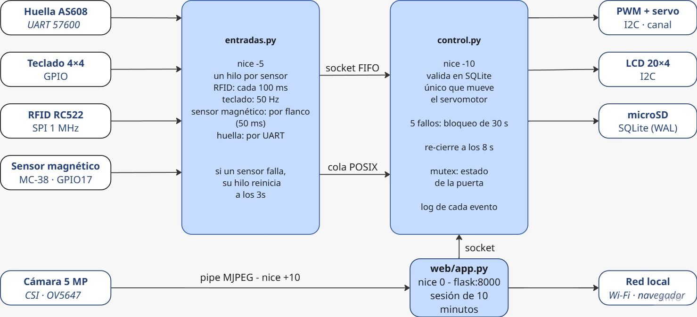

# Cerradura multifactor — Equipo 8 (FSE)

Arquitectura:
- Raspberry Pi 3B 
- Raspberry Pi OS Raspbian
- Python 3

Acceso con tarjeta RFID, PIN o huella; servomotor por PWM de hardware; LCD de estado;
sensor de puerta; app web con video en vivo, apertura remota, alertas, historial, alta y
baja de usuarios (con tarjeta y/o huella) y respaldos.



## Procesos

| Proceso (servicio) | Archivo | Qué hace | nice |
|---|---|---|---|
| `cerradura-control` | `control.py` | Valida credenciales, mueve el servo (PCA9685), LCD, logs, alertas, bloqueo por intentos, registro de tarjeta y huella | -10 |
| `cerradura-entradas` | `entradas.py` | Un hilo por sensor: huella (UART), RFID (SPI), teclado (GPIO), reed (GPIO); el de la huella también registra y borra plantillas | -5 |
| `cerradura-web` | `web/app.py` | App web en el puerto 8000; la cámara (`rpicam-vid`) entra por un pipe con nice +10 | 0 |
| `cerradura-respaldo` (timer) | `respaldo.py` | Respaldo diario de la base a la tarjeta y a una memoria USB | +10 |

Comunicación: entradas y web → control por **socket UNIX** (`/tmp/cerradura_control.sock`, una
solicitud a la vez); reed → control por **cola de mensajes POSIX** (`/cerradura_puerta`);
control → entradas por otra **cola POSIX** (`/cerradura_ordenes`: registrar o borrar una huella);
cámara → web por **pipe**. Usuarios, logs y alertas en SQLite (`/var/lib/cerradura/cerradura.db`).

| Archivo | Función |
|---|---|
| `config.py` | Pines, direcciones I2C, tiempos, prioridades |
| `db.py` | SQLite (WAL + synchronous=FULL); PIN con HMAC-SHA256, contraseñas web con scrypt |
| `ipc.py` | Socket UNIX y colas de mensajes |
| `admin.py` | Usuarios, PIN, tarjeta, huella, administradores web, logs, medición, respaldos |
| `respaldo.py` | Respaldo y restauración de la base y de la llave de los PIN |
| `hw/` | Drivers propios: `pca9685.py`, `lcd.py` (PCF8574), `rc522.py` |
| `camara.py` | Lee el video MJPEG de `rpicam-vid` por un pipe |
| `web/` | `app.py` (Flask), `templates/`, `static/` (estilo y fuente Nunito, licencia OFL) |
| `evidencia.sh` | Junta la evidencia de terminal para el reporte |

## Conexiones

| Módulo | Pin del módulo | Raspberry Pi (pin físico) |
|---|---|---|
| **AS608** | VCC / GND | 3.3V (1) / GND (6) |
| | TX / RX | GPIO15 RXD (10) / GPIO14 TXD (8) |
| **RC522** | 3.3V y RST / GND | 3.3V (17) / GND (20) |
| | SDA(SS) / SCK | GPIO8 CE0 (24) / GPIO11 (23) |
| | MOSI / MISO | GPIO10 (19) / GPIO9 (21) |
| **Teclado 4x4** | F1 F2 F3 F4 | GPIO5 (29), GPIO6 (31), GPIO13 (33), GPIO19 (35) |
| | C1 C2 C3 C4 | GPIO12 (32), GPIO16 (36), GPIO20 (38), GPIO21 (40) |
| **Reed MC-38** | 2 cables | GPIO17 (11) y GND (9) |
| **PCA9685** | VCC / GND | 3.3V (1) / GND (14) |
| | SDA / SCL | GPIO2 (3) / GPIO3 (5) |
| | V+ (servo) | **Fuente externa 5V** (GND común con la Pi) |
| | Canal 15 | Señal del servo |
| **LCD 2004 + PCF8574** | VCC / GND | 3.3V (1) / GND (25) |
| | SDA / SCL | GPIO2 (3) / GPIO3 (5) |
| **Cámara Rev 1.3** | Cinta plana | Conector CSI |

> El servo NO se alimenta de la Pi. El UPS se dejó como análisis teórico (ver el reporte del Avance 3).

## Instalación reproducible

En una Raspberry Pi OS recién instalada:

```bash
git clone https://github.com/lued2897/Embebidos && cd Embebidos/cerradura
git checkout v4.0                      # versión de este avance
sudo ./instalar.sh                     # buses, paquetes, venv, servicios
sudo reboot
i2cdetect -y 1                         # debe mostrar 40 (PCA9685) y 27 (LCD)
cd /opt/cerradura && sudo venv/bin/python admin.py web-admin grecia
```

`instalar.sh` se puede volver a correr para actualizar el código. Los tres servicios arrancan
solos al encender y se reinician en 2 s si se caen.

## Registrar usuarios

Desde la app web, en **Usuarios**: se agrega el nombre (y PIN, opcional) y luego **Registrar**
tarjeta o huella. Hay 30 s para acercar la tarjeta o poner el dedo dos veces, siguiendo el LCD.
**Eliminar** borra al usuario y también su huella del sensor AS608.

Por consola (con el proceso de entradas detenido, porque usa los lectores):

```bash
cd /opt/cerradura
sudo systemctl stop cerradura-entradas
sudo venv/bin/python admin.py agregar claudio
sudo venv/bin/python admin.py pin claudio
sudo venv/bin/python admin.py tarjeta claudio
sudo venv/bin/python admin.py huella claudio
sudo systemctl start cerradura-entradas
```

## App web

`http://<ip-de-la-pi>:8000` desde la red local. 5 intentos fallidos bloquean el login 60 s.

| Página | Qué muestra |
|---|---|
| Panel | Estado de la puerta, apertura remota, video en vivo, alertas y últimos eventos |
| Alertas | Todas las alertas con su nivel; se marcan como vistas |
| Historial | Eventos con búsqueda por texto y por método |
| Usuarios | Alta y baja; registro de tarjeta, huella y PIN |
| Respaldos | Respaldos guardados, si están íntegros y botón para respaldar ahora |

## Alertas

| Alerta | Nivel | Quién la genera |
|---|---|---|
| Puerta abierta sin autorización | crítica | control (reed sin apertura concedida) |
| Puerta abierta más de 60 s | aviso | control (`PUERTA_ABIERTA_ALERTA_S`) |
| Bloqueo por 5 intentos fallidos | crítica | control |
| Sensor que deja de responder / vuelve | crítica / info | entradas (una alerta por cambio) |
| Login web bloqueado | aviso | web |
| Respaldo fallido | crítica o aviso | respaldo |

## Respaldos

Sin UPS, un corte de luz puede dañar la microSD. Cada día a las 3:30 (o al encender, si la Pi
estaba apagada) `cerradura-respaldo.timer` copia la base y la llave de los PIN a
`/var/lib/cerradura/respaldos` y, si está conectada, a una memoria USB con etiqueta `CERRADURA`
(se monta en `/mnt/respaldo`). Se guardan los últimos 7 de cada lugar, cada uno con su SHA-256.

```bash
sudo venv/bin/python admin.py respaldar        # ahora (también desde la app: Respaldos)
sudo venv/bin/python admin.py respaldos        # lista
sudo systemctl stop cerradura-web cerradura-entradas cerradura-control
sudo venv/bin/python admin.py restaurar /mnt/respaldo/cerradura/respaldo_AAAAMMDD_HHMMSS
sudo systemctl start cerradura-control cerradura-entradas cerradura-web
```

Antes de restaurar se guarda la base actual en `respaldos/antes_de_restaurar_<fecha>`.

## Pruebas, mediciones y fallas inducidas

```bash
cd /opt/cerradura
sudo venv/bin/python admin.py medir             # latencia credencial -> servo (requisito < 3 s)
sudo venv/bin/python admin.py logs 30
sudo pkill -9 -f control.py                     # falla: el control muere; systemd lo levanta en 2 s
journalctl -fu cerradura-control -fu cerradura-entradas -fu cerradura-web
sudo ./evidencia.sh                             # (desde la carpeta del repo) evidencia para el reporte
```

### Sin hardware (simulación)

```bash
CERRADURA_DATA=./datos python3 control.py --sim      # terminal 1
CERRADURA_DATA=./datos python3 entradas.py --sim     # terminal 2
> rfid A1B2C3D4
> pin 1234
> puerta abierta
```

## Versiones

| Etiqueta | Avance |
|---|---|
| `v2.0` | Módulo de entradas y control |
| `v3.0` | Sistema completo: huella, cámara, app web, prioridades |
| `v4.0` | Alertas, alta y baja completas desde la web, respaldos |
